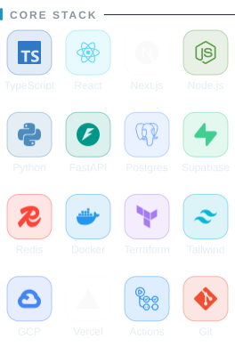
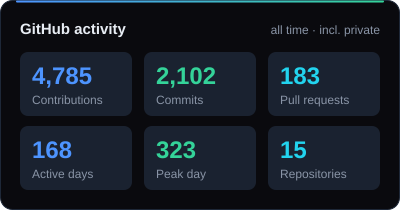
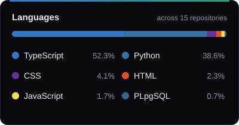
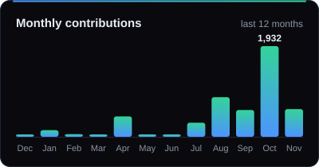
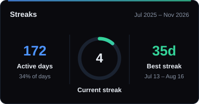

<!--
  Walid Adra — GitHub profile README.
  Cards under assets/ are rebuilt daily by .github/workflows/stats.yml (scripts/build-stats.mjs);
  the contribution snake by .github/workflows/snake.yml.
-->

<a href="https://walidadra.dev"><picture><source media="(prefers-color-scheme: light)" srcset="./assets/header-light.svg" /></picture></a>

## 👋 About Me

I'm a self-taught full-stack software developer in **Tripoli, Lebanon**, coding since 2019 and working remotely across EMEA hours. I don't have an engineering degree yet; I take on engineering-level work, and becoming a software engineer is where I'm heading.

I build and run production web systems end to end: the data model, the API, the interface, the deploy, and the security, tests and backups that keep a live business running. I run **[WebRift](https://webrift.dev)**, my solo software agency: online stores, restaurant platforms, websites and AI tools, built for clients from scratch. As a freelancer I built an AI voice-interview HR platform for a client, and I owned the UI/UX layer of **Aris AI**, a real-time trading platform.

- 🔭 &nbsp;**Building** — WebRift client platforms · WebRift OS
- 🎯 &nbsp;**Focus** — commerce &amp; data integrity · edge infrastructure · interfaces that hold up on any phone
- 🌍 &nbsp;**Languages** — English · Arabic (real RTL in production)
- ⚡ &nbsp;**Open to** — full-time, contract &amp; freelance · remote · EMEA hours

## 🧩 What I Build

<table>
<tr>
<td width="50%" valign="top">

#### 🛒 Commerce that can't oversell
Checkout in one transaction, row locks on anything two buyers can claim at once, prices decided on the server, and caching that keeps a free-tier database alive.

</td>
<td width="50%" valign="top">

#### ☁️ Edge &amp; infrastructure
Next.js on Vercel and Cloudflare Workers (R2, D1, Hyperdrive, Durable Objects), Postgres on Neon and Supabase, CI that gates lint, types, tests and build.

</td>
</tr>
<tr>
<td width="50%" valign="top">

#### 🔐 Security &amp; reliability
Row-level security, 2FA, rate limits that hold across instances, strict CSP, and encrypted backups that are restore-tested every night.

</td>
<td width="50%" valign="top">

#### 🖥️ Interfaces that hold up
Bilingual EN/AR with real RTL, theme systems, mobile-first layouts tested on real iOS and Android quirks, motion and 3D, WCAG 2.2 AA.

</td>
</tr>
</table>

## 🛠️ Tech Stack

  <picture>
    <source media="(prefers-color-scheme: light)" srcset="./assets/core-light.svg" />
    
  </picture>
  &nbsp;&nbsp;&nbsp;
  <picture>
    <source media="(prefers-color-scheme: light)" srcset="./assets/stack-light.svg" />
    
  </picture>

## 🚀 Featured Work

<table>
<tr>
<td width="50%" valign="top">

#### 🛍️ [Trendeall](https://trendeall.com)
 

E-commerce platform: checkout safe under concurrency, nightly encrypted backups with a restore test.

`Next.js 16` `Payload 3` `Neon Postgres` `R2`

21 collections · 42 migrations · ~340 tests

</td>
<td width="50%" valign="top">

#### 👟 [HypeWalk](https://hypewalk.store)
 

Sneaker store migrated from Vercel to Cloudflare Workers, with a custom WebAssembly image kernel to fit 128 MB.

`Cloudflare Workers` `Hyperdrive` `R2` `AssemblyScript`

~500 unit + 59 Playwright tests

</td>
</tr>
<tr>
<td width="50%" valign="top">

#### 📈 Aris AI — Trading Platform

Owned UI/UX and the visual layer: theme system, mobile live-trading layout, fullscreen charts.

`React` `TypeScript` `Zustand` `Socket.IO`

37 routes · 220 components

</td>
<td width="50%" valign="top">

#### 🧭 WebRift OS
 

The private operating system that runs the agency: leads, proposals, pricing, invoicing, automated video production, and AI agents that route each task to a local or cloud model.

`Next.js 16` `Claude API` `SQLite + Litestream` `n8n`

224 API routes · ~1,300 tests

</td>
</tr>
<tr>
<td width="50%" valign="top">

#### 🐟 [Al Mahramji](https://almahramji.com)
 

Bilingual QR menu and CMS for a seafood restaurant, run by the owner.

`Next.js 16` `Supabase` `RLS` `TOTP 2FA`

23 tables under row-level security

</td>
<td width="50%" valign="top">

#### 🛰️ [WebRift](https://webrift.dev) &amp; [walidadra.dev](https://walidadra.dev)

Hand-built agency and portfolio sites, no framework. Mobile LCP 2.29 s on throttled 4G.

`JavaScript` `GSAP` `three.js` `Cloudflare Workers`

534 Playwright tests · WCAG 2.2 AA

</td>
</tr>
</table>

**Open source:** merged fix to [claude-video-vision #23](https://github.com/jordanrendric/claude-video-vision/pull/23), a Claude Code video plugin: fixed local Whisper transcription by dropping an unsupported flag and pinning the output directory.

## 📐 Engineering Principles

1. **Money and stock change in one transaction, or not at all.**
2. **Every read on a page view has a price.** Cache it before the bill or the outage arrives.
3. **A backup nobody has restored is a hope, not a backup.**
4. **Access is a grant,** never a URL somebody could guess.
5. **Measure on the slowest phone first.**
6. **A test that can't fail isn't a test.**

How each one is enforced in real systems → <a href="https://walidadra.dev/engineering.html">walidadra.dev/engineering</a>

## 📊 GitHub Analytics

Most of my work lives in private client repositories. These cards count it without naming it, and refresh daily.

<picture><source media="(prefers-color-scheme: light)" srcset="./assets/stats-light.svg" /></picture>
<picture><source media="(prefers-color-scheme: light)" srcset="./assets/languages-light.svg" /></picture>
<picture><source media="(prefers-color-scheme: light)" srcset="./assets/activity-light.svg" /></picture>
<picture><source media="(prefers-color-scheme: light)" srcset="./assets/streak-light.svg" /></picture>

 

<picture>
  <source media="(prefers-color-scheme: dark)" srcset="https://raw.githubusercontent.com/Walidd22/Walidd22/output/snake-dark.svg" />
  
</picture>

 

<a href="https://walidadra.dev"><picture><source media="(prefers-color-scheme: light)" srcset="./assets/footer-light.svg" /></picture></a>
